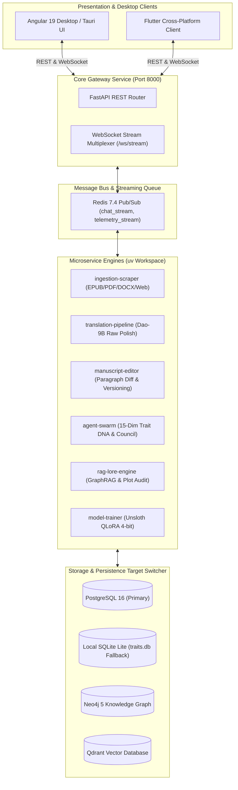
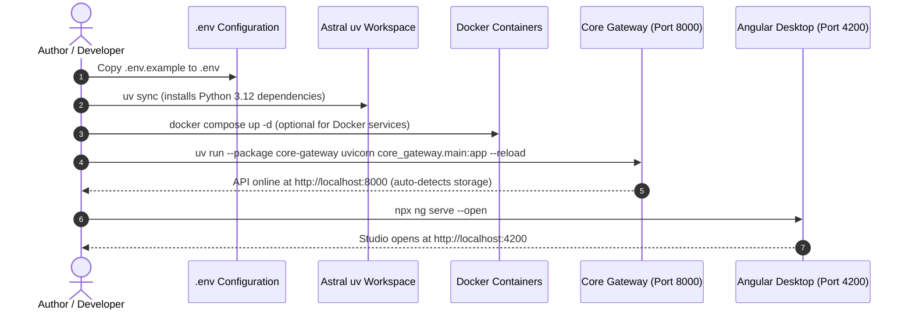
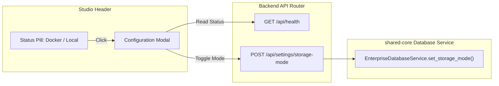

<div align="center">

  

  # OmniScribe Studio (*Codename: DaoForge*)
  **Autonomous Multi-Agent Literary Engine, World-Building Graph & RL Manuscript Suite**

  [](https://python.org)
  [](https://docs.astral.sh/uv/)
  [](https://fastapi.tiangolo.com)
  [](https://angular.dev)
  [](https://neo4j.com)
  [](LICENSE)

  ---

  <!-- Top Horizontal Interactive Navigation Bar -->
  <p align="center">
    <a href="#overview"><kbd> Overview </kbd></a> •
    <a href="#system-architecture"><kbd> Architecture </kbd></a> •
    <a href="#project-tree-structure"><kbd> Project Tree </kbd></a> •
    <a href="#complete-quick-start-guide"><kbd> Quick Start </kbd></a> •
    <a href="#docker-services-and-storage-backend-switching"><kbd> Docker & Storage Switch </kbd></a> •
    <a href="docs/ARCHITECTURE.md"><kbd> Architecture Spec </kbd></a> •
    <a href="docs/CONTRIBUTING.md"><kbd> Contributing </kbd></a>
  </p>

  <!-- Interactive Document Links -->
  <p align="center">
    <a href="services/shared-core/pyproject.toml"><kbd> shared-core </kbd></a> |
    <a href="services/core-gateway/src/core_gateway/main.py"><kbd> core-gateway </kbd></a> |
    <a href="services/ingestion-scraper/src/ingestion_scraper/site_adapters.py"><kbd> ingestion-scraper </kbd></a> |
    <a href="services/agent-swarm/src/agent_swarm/trait_engine.py"><kbd> agent-swarm </kbd></a> |
    <a href="services/manuscript-editor/src/manuscript_editor/editor_engine.py"><kbd> manuscript-editor </kbd></a> |
    <a href="services/rag-lore-engine/src/rag_lore_engine/lore_auditor.py"><kbd> rag-lore-engine </kbd></a> |
    <a href="services/model-trainer/src/model_trainer/unsloth_trainer.py"><kbd> model-trainer </kbd></a>
  </p>

  ---
</div>

## Table of Contents

- [Overview](#overview)
- [System Architecture](#system-architecture)
- [Project Tree Structure](#project-tree-structure)
- [Complete Quick Start Guide](#complete-quick-start-guide)
  - [Step 1: Environment Configuration](#step-1-environment-configuration)
  - [Step 2: Install Python 3.12 and Sync uv Workspace](#step-2-install-python-312-and-sync-uv-workspace)
  - [Step 3: Start Docker Persistence Infrastructure](#step-3-start-docker-persistence-infrastructure)
  - [Step 4: Launch Core Gateway Backend (Hot Reload)](#step-4-launch-core-gateway-backend-hot-reload)
  - [Step 5: Launch Frontend Interface (Angular / Desktop)](#step-5-launch-frontend-interface-angular--desktop)
- [Docker Services and Storage Backend Switching](#docker-services-and-storage-backend-switching)
- [Microservices Breakdown](#microservices-breakdown)
  - [1. shared-core](#1-serviceshared-core)
  - [2. core-gateway](#2-servicescore-gateway)
  - [3. ingestion-scraper](#3-servicesingestion-scraper)
  - [4. translation-pipeline](#4-servicestranslation-pipeline)
  - [5. agent-swarm](#5-servicesagent-swarm)
  - [6. manuscript-editor](#6-servicesmanuscript-editor)
  - [7. rag-lore-engine](#7-servicesrag-lore-engine)
  - [8. model-trainer](#8-servicesmodel-trainer)
- [Supported Genres, Categories, and Uncensored Writing](#supported-genres-categories-and-uncensored-writing)
- [Multi-Format File Ingestion and Scalable Web Scraping](#multi-format-file-ingestion-and-scalable-web-scraping)
- [Reinforcement Learning and 15-Dimension Trait DNA Engine](#reinforcement-learning-and-15-dimension-trait-dna-engine)
- [Open Source Models for Novel Writing and Translation](#open-source-models-for-novel-writing-and-translation)
- [User Interfaces: Flutter and Angular Desktop UI](#user-interfaces-flutter-and-angular-desktop-ui)
- [Running the Test Suite](#running-the-test-suite)
- [API Reference](#api-reference)
- [License](#license)

---

## Overview

**OmniScribe Studio** is a production-grade AI literary ecosystem and microservice workspace designed specifically for authors, novelists, and translators writing across **Xianxia, Wuxia, Xuanhuan, Western Fantasy, LitRPG/Progression, Cyberpunk, Steampunk, Sci-Fi, Romance, Historical Fiction, Urban Supernatural, Horror, Mystery, and Dark/Mature Fiction**.

Standard general-purpose chatbots fall short when generating multi-volume book manuscripts: they hallucinate continuity details, inject repetitive chatbot cliches, fail to capture authentic genre terminology, and self-censor mature or gritty combat scenes. OmniScribe Studio resolves these issues through specialized architecture:

1. **Zero Chatbot Cliches:** Strips em-dashes (`—`), semicolons (`;`), and robotic phrasing (`a testament to`, `a shiver ran down his spine`, `couldn't help but`) via grammar and AST scrubbers.
2. **Reinforced Personality Evolution (Trait DNA):** Writing agents are not static system prompts. Each agent is governed by a 15-dimension numerical trait vector that dynamically compiles prompting directives and continuously self-tunes via author feedback and implicit edit distance.
3. **Universal Ingestion and Anti-Duplication:** Parses files from local systems (`.epub`, `.pdf`, `.docx`, `.md`, `.txt`, and raw chapter folders) and scrapes web novels from sources like Twkan, 69shuba, WTR-Lab, OpenNovel, and Project Gutenberg with automated DOM noise removal and SHA-256 deduplication.
4. **Continuous Model Training and Fine-Tuning:** Transforms accepted prose, polished chapters, and crawled web novels into continuation instruction datasets with automated scripts for 4-bit QLoRA fine-tuning with Unsloth.
5. **Granular Paragraph Versioning:** Every paragraph has individual version tracking, diff calculation, and one-click rollback to prevent deadlock during editing.
6. **No Content Restrictions:** Dedicated uncensored model routing (`Nyx 14B`, `Dolphin Mistral-Nemo 12B`) guarantees that gritty battles, dark horror, visceral descriptions, and mature themes remain unneutered.
7. **Storage Backend Flexibility:** Live UI status indicator with a configuration modal showing whether Docker persistence services (Postgres, Neo4j, Qdrant, Redis) are online or falling back to local SQLite lite mode (`data/trait_engine/traits.db`), with instant manual switching.

---

## System Architecture

OmniScribe Studio is architected as an event-driven microservices workspace powered by Python 3.12, Astral `uv`, Redis 7.4 Streams, PostgreSQL 16 (with automatic zero-config SQLite failover), Neo4j 5 Graph Database, and Qdrant Vector Search.



---

## Project Tree Structure

<details open>
<summary><b>Click to Expand / Collapse Complete Project Tree</b></summary>

```text
omniscribe-studio/
├── .env.example                               # Environment template with preconfigured ports & credentials
├── .env                                       # Active local environment variables
├── .gitignore                                 # Git rules excluding docker mounts, .venv, node_modules
├── .python-version                            # Pinned Python version (3.12)
├── docker-compose.yml                         # Multi-container orchestration (Postgres, Neo4j, Qdrant, Redis, FlareSolverr)
├── pyproject.toml                             # Root Astral uv workspace configuration
├── README.md                                  # Complete project documentation
├── data/                                      # Polyglot persistent storage mounts & generated datasets
│   ├── lora_adapters/                         # Generated Unsloth fine-tuning scripts and LoRA weights
│   ├── neo4j/                                 # Neo4j graph data, logs, and import mounts
│   ├── postgres/                              # PostgreSQL 16 database cluster files
│   ├── qdrant/                                # Qdrant vector database storage
│   ├── redis/                                 # Redis append-only files (AOF)
│   ├── training_datasets/                     # Generated genre-tagged JSONL instruction pairs
│   └── trait_engine/                          # Local SQLite lite fallback database and evolution logs
│       ├── trait_evolution_log.jsonl          # Comprehensive audit trail of agent personality shifts
│       └── traits.db                          # SQLite mirror and offline relational store
├── docs/                                      # Architectural and contribution documentation
│   ├── ARCHITECTURE.md                        # Technical architecture deep dive and state machines
│   ├── CONTRIBUTING.md                        # Development setup and contributor guidelines
│   └── assets/                                # Brand assets and studio logos
│       └── omniscribe-logo.svg                # Vector SVG logo for splash screens and badges
├── frontend-angular/                          # Angular 19 Desktop application with Tauri bindings
│   ├── package.json                           # Frontend dependencies and scripts
│   ├── src/                                   # Angular application source code
│   │   ├── app/
│   │   │   ├── app.component.css              # Custom styling for Dark Obsidian, Light Parchment, and Grey Studio modes
│   │   │   ├── app.component.html             # Split-screen workspace, status pill, and modal template
│   │   │   └── app.component.ts               # Component logic, storage switcher, and WebSocket handler
│   │   ├── index.html                         # Root HTML entry point
│   │   └── styles.css                         # Global CSS rules
│   └── src-tauri/                             # Tauri configuration for desktop compilation
├── services/                                  # Modular uv workspace microservices
│   ├── agent-swarm/                           # 15-Dimension Trait DNA engine & parallel multi-agent council
│   │   ├── pyproject.toml
│   │   └── src/agent_swarm/
│   │       ├── dynamic_prompt_builder.py      # Numerical vector to prompt instruction compiler
│   │       ├── feedback_engine.py             # Explicit ratings and implicit edit distance processor
│   │       ├── orchestrator.py                # Asynchronous agent task dispatcher
│   │       ├── topic_router.py                # Contextual agent selection
│   │       └── trait_engine.py                # Clamped boundary evolution and seed data
│   ├── core-gateway/                          # FastAPI REST API and WebSocket hub
│   │   ├── pyproject.toml
│   │   └── src/core_gateway/
│   │       └── main.py                        # REST routers, health diagnostics, and WebSocket multiplexer
│   ├── ingestion-scraper/                     # Multi-format novel parser and web scrapers
│   │   ├── pyproject.toml
│   │   └── src/ingestion_scraper/
│   │       ├── parser_and_scraper.py          # EPUB, PDF, DOCX, and directory parser
│   │       └── site_adapters.py               # Adapters for Twkan, 69shuba, WTR, OpenNovel, Gutenberg
│   ├── manuscript-editor/                     # Paragraph versioning and anti-cliche scrubber
│   │   ├── pyproject.toml
│   │   └── src/manuscript_editor/
│   │       └── editor_engine.py               # Paragraph diff tracking, undo engine, and AST cleaner
│   ├── model-trainer/                         # Continuous reinforcement and QLoRA fine-tuning
│   │   ├── pyproject.toml
│   │   └── src/model_trainer/
│   │       └── unsloth_trainer.py             # Dataset exporter and Unsloth 4-bit script generator
│   ├── rag-lore-engine/                       # GraphRAG knowledge graph and plotline auditor
│   │   ├── pyproject.toml
│   │   └── src/rag_lore_engine/
│   │       └── lore_auditor.py                # Neo4j character tracker and plotline predictor
│   ├── shared-core/                           # Enterprise database service and telemetry bus
│   │   ├── pyproject.toml
│   │   └── src/shared_core/
│   │       ├── config.py                      # Centralized Pydantic Settings
│   │       └── enterprise_database_service.py # PostgreSQL/SQLite failover and storage switcher
│   └── translation-pipeline/                  # Dao-9B translation engine and MTL polisher
│       ├── pyproject.toml
│       └── src/translation_pipeline/
│           └── translator.py                  # Parallel paragraph translation with term glossaries
└── tests/                                     # Automated test suite
    └── test_omniscribe_core.py                # Trait DNA bounds, prompt builder, anti-cliche, and extractor tests
```

</details>

---

## Complete Quick Start Guide

Follow these steps to configure your environment, run the backend with hot reload, start the Docker services (or run in local lite mode), and launch the frontend.



### Step 1: Environment Configuration
Copy the provided environment template to create your `.env` file:
```bash
# On Windows (PowerShell):
Copy-Item .env.example .env

# On Linux / macOS (Bash):
cp .env.example .env
```
The preconfigured defaults work out-of-the-box for both local development and Docker deployment.

### Step 2: Install Python 3.12 and Sync uv Workspace
Ensure [Astral `uv`](https://docs.astral.sh/uv/) is installed on your system:
```bash
# Pin Python 3.12
uv python pin 3.12

# Synchronize all eight microservice dependencies in the workspace
uv sync
```

### Step 3: Start Docker Persistence Infrastructure
If you wish to use the full enterprise stack (PostgreSQL, Neo4j, Qdrant, Redis, and FlareSolverr):
```bash
docker compose up -d
```
*Note: If Docker is not running or you prefer a lightweight local setup, OmniScribe Studio automatically falls back to its built-in SQLite engine (`data/trait_engine/traits.db`). You do not need to install Postgres or Redis to start writing immediately.*

### Step 4: Launch Core Gateway Backend (Hot Reload)
Run the backend gateway with hot reload enabled on port 8000:
```bash
uv run --package core-gateway uvicorn core_gateway.main:app --reload --host 0.0.0.0 --port 8000
```
- Interactive API Documentation (Swagger UI): `http://localhost:8000/docs`
- Service Health Diagnostics: `http://localhost:8000/api/health`

### Step 5: Launch Frontend Interface (Angular / Desktop)
Open a new terminal window, navigate to the frontend directory, install dependencies, and start the development server with live reload:
```bash
cd frontend-angular
npm install
npx ng serve --open
```
The studio workspace will open automatically at `http://localhost:4200`.

---

## Docker Services and Storage Backend Switching

OmniScribe Studio provides dual-mode data persistence:
1. **Docker Services Mode (Enterprise Stack):**
   - **PostgreSQL 16**: Primary storage for agent trait DNA, manuscripts, and version histories.
   - **Neo4j 5**: Knowledge graph tracking character profiles, sect relationships, and cultivation realm trees.
   - **Qdrant**: Vector database providing semantic search across previous chapters and lore files.
   - **Redis 7.4**: High-throughput Pub/Sub bus broadcasting parallel agent chat and telemetry logs.
   - **FlareSolverr**: Headless browser proxy bypassing Cloudflare protections on crawled novel sites.
2. **Local Lite Mode (Zero-Config Fallback):**
   - **SQLite**: Local file database at `data/trait_engine/traits.db` storing all agent traits, paragraph version diffs, and evolution logs.
   - **In-Memory Graphs & Vectors**: Lightweight local mocks allowing the editor to function completely offline without Docker.

### Live UI Status & Manual Storage Switcher
In the top header of the UI, an interactive status pill indicates the current storage destination:
- **Green Indicator ("Storage: Docker Services")**: Data is streaming to the active Docker containers.
- **Amber Indicator ("Storage: Local SQLite Lite")**: Data is saved to the local `data/trait_engine/traits.db` SQLite database.

Clicking the **"Configure"** button opens the **Engine & Storage Configuration Modal**, where authors can:
- View the real-time connectivity status of PostgreSQL, Neo4j, Qdrant, and Redis.
- Manually switch between **Docker Services** and **Local Lite Mode** with a single click.



---

## Microservices Breakdown

### 1. `services/shared-core`
The foundational layer shared across all microservices:
- **`enterprise_database_service.py`**: Manages unified connection pools for PostgreSQL, Neo4j, Qdrant, and Redis. Automatically detects database availability and falls back to local SQLite (`data/trait_engine/traits.db`) when external engines are offline.
- **`config.py`**: Centralized configuration management using Pydantic Settings reading from environment variables or `.env`.
- **Telemetry Bus**: Broadcasts real-time events, progress updates, and agent status messages to Redis pub/sub.

### 2. `services/core-gateway`
The unified entry point for client applications:
- **REST Endpoints**: Chapter ingestion, full-novel translation triggers, plotline planning, character profile generation, storage mode switching, and model training invocation.
- **WebSocket Hub**: Supports non-blocking multiplexed bidirectional communication. Authors can continue prompting, editing, and dispatching tasks while agents compute in the background.

### 3. `services/ingestion-scraper`
Handles raw text ingestion and web crawling:
- **Local File Parsers**: Ingests `.epub`, `.pdf`, `.docx`, `.md`, and `.txt` files with metadata preservation.
- **Deduplication Engine**: Uses SHA-256 fingerprinting and semantic similarity to prevent duplicate paragraphs or chapters from contaminating the corpus.
- **Scalable Web Scrapers**: Dedicated site adapters for platforms such as Twkan, 69shuba, WTR-Lab, OpenNovel, and Project Gutenberg. Integrated with FlareSolverr for Cloudflare-protected sites.

### 4. `services/translation-pipeline`
Specialized translation and raw MTL polishing:
- Powered by `Dao-9B` and local LLM backends.
- Retains authentic genre terminology (Daoist concepts, cultivation realms, martial stances, cyberpunk slang).
- Processes large manuscripts in parallel paragraph batches with glossaries to ensure name consistency across chapters.

### 5. `services/agent-swarm`
The multi-agent writer's room and RL orchestration engine:
- **`trait_engine.py`**: Manages 15-dimension personality vectors for each agent.
- **`dynamic_prompt_builder.py`**: Compiles numerical trait vectors into real-time behavioral directives.
- **`topic_router.py`**: Directs requests to specialized agents based on genre and narrative context.
- **`feedback_engine.py`**: Adjusts trait vectors using explicit ratings (`/rate good`, `/rate bad`) and implicit author edits (Levenshtein edit distance).

### 6. `services/manuscript-editor`
Granular manuscript operations:
- Paragraph-by-paragraph version history with instant rollback.
- Anti-cliche filtering that strips em-dashes, semicolons, and formulaic chatbot phrases.
- Deadlock-free writing and editing pipelines.

### 7. `services/rag-lore-engine`
World-building and narrative continuity:
- **Neo4j Knowledge Graph**: Stores character profiles, faction hierarchies, realm progressions, and relationship graphs.
- **Qdrant Vector Store**: Semantic indexing of previous chapters for context retrieval.
- **Lore Auditor**: Detects continuity flaws, contradictory character actions, and broken plotlines before text is finalized.

### 8. `services/model-trainer`
Continuous reinforcement and model customization:
- Converts ingested chapters and accepted author edits into instruction-following JSONL datasets.
- Generates reproducible Unsloth 4-bit QLoRA training scripts.
- Supports incremental fine-tuning on local GPUs.

---

## Supported Genres, Categories, and Uncensored Writing

OmniScribe Studio includes built-in knowledge bases, prompt templates, and agent personalities for:

| Category | Primary Focus & Archetypes |
|---|---|
| **Xianxia & Cultivation** | Qi condensation, golden cores, tribulation lightning, daoist philosophy, sect politics. |
| **Wuxia & Martial Arts** | Jianghu honor codes, meridian pathways, weapon styles, martial arts tournaments. |
| **Western & Epic Fantasy** | High magic systems, medieval geopolitics, dungeon mechanics, mythical beasts. |
| **Cyberpunk & Sci-Fi** | Megacorporations, cyberware, netrunning, dystopian urban landscapes, orbital colonies. |
| **Steampunk & Victorian** | Clockwork automation, steam-powered locomotives, Victorian etiquette, alchemical societies. |
| **Romance & Drama** | Slow-burn character arcs, emotional tension, dialogue subtext, relationship dynamics. |
| **Horror & Supernatural** | Psychological dread, eldritch deities, visceral atmosphere, investigative pacing. |
| **Dark & Mature Fiction** | Unfiltered gritty combat, high-stakes moral dilemmas, uncensored narrative freedom. |

---

## Multi-Format File Ingestion and Scalable Web Scraping

OmniScribe Studio processes local documents and online novels with high throughput:

### Local File Formats
- **EPUB (`.epub`)**: Parses spine items, removes CSS and boilerplate tags, extracts clean chapter headings and body paragraphs.
- **PDF (`.pdf`)**: Extracts continuous multi-page prose while repairing broken line wraps and stripping headers and footers.
- **Word (`.docx`)**: Preserves heading hierarchies and extracts styled paragraphs.
- **Markdown (`.md`) and Text (`.txt`)**: Splits chapters using regex heuristics (`Chapter \d+`, `第.+章`).

### Scalable Web Novel Scraping
The `ingestion-scraper` service includes dedicated adapters for major web-novel sites:
- **Twkan (`twkan.com`)**: Optimized CSS selector extraction with automatic advertisement scrubbing.
- **69shuba (`69shuba.com`)**: GBK encoding decoding, removal of pagination watermarks and reading reminders.
- **WTR-Lab (`wtr-lab.com`)**: Ingests raw machine translations and translated web-novel chapters.
- **OpenNovel (`opennovel.co`)**: Modern HTML container extraction with ad-slot filtering.
- **Project Gutenberg (`gutenberg.org`)**: Strips Gutenberg legal license headers and footers for public domain training text.

---

## Reinforcement Learning and 15-Dimension Trait DNA Engine

Every writing agent in OmniScribe Studio is governed by a **15-dimension numerical personality vector** normalized between `0.0` and `1.0`. These vectors evolve dynamically based on how the author interacts with the generated prose.

### The 15 Trait Dimensions
1. **`pacing`**: Fast kinetic progression vs. slow atmospheric world-building.
2. **`dialogue_ratio`**: Heavy character interaction vs. dense narrative exposition.
3. **`sensory_detail`**: Vivid visual/auditory/olfactory immersion level.
4. **`combat_grit`**: Visceral, bone-crunching choreography vs. abstract power scaling.
5. **`poeticism`**: Flowing metaphorical prose vs. sharp minimalist economy.
6. **`archaism`**: Classical phrasing and archaic vocabulary vs. contemporary style.
7. **`darkness`**: Bleak themes, psychological weight, and mature stakes.
8. **`verbosity`**: Descriptive paragraph length and elaboration.
9. **`emotional_resonance`**: Deep internal character monologue and psychological stakes.
10. **`comedic_undertone`**: Satirical wit and comedic relief vs. strict solemnity.
11. **`mystery_suspense`**: Cryptic foreshadowing and delayed exposition.
12. **`philosophical_depth`**: Exploration of Daoist, existential, or ideological themes.
13. **`formality`**: Polished courtly etiquette vs. colloquial speech.
14. **`metaphor_frequency`**: Density of symbolic imagery and analogical descriptions.
15. **`ruthlessness`**: Decisive, proactive protagonist actions vs. merciful hesitation.

---

## Open Source Models for Novel Writing and Translation

OmniScribe Studio is built to run entirely on local GPUs via **vLLM**, **Ollama**, or **LiteLLM**. Recommended open-source weights:

| Model ID | Optimal Role | Recommended Precision | Context Length |
|---|---|---|---|
| **Dao-9B** | Chinese Xianxia/Wuxia to English Raw Translation | 4-bit / 8-bit GGUF, BF16 | 8K - 16K |
| **Qwen-2.5-14B-Instruct** | General Prose, Chapter Planning, World-Building | Q4_K_M / Q8_0 GGUF, AWQ | 32K - 128K |
| **Qwen-2.5-7B-Instruct** | Fast Scene Drafting and Dialogue Generation | 4-bit GGUF, EXL2 | 32K |
| **Dolphin-2.9.2-Mistral-Nemo-12B** | Uncensored Dark Fantasy, Horror, Mature Themes | Q5_K_M GGUF, AWQ | 16K - 32K |
| **Command-R / Command-R+ (35B-104B)** | Extended Context Continuity Auditing and Plot RAG | Q4_K_M GGUF | 128K |
| **BGE-Large-EN-v1.5 / BGE-M3** | Dense Vector Embeddings for Qdrant Lore Retrieval | FP16, INT8 | 8K |

---

## User Interfaces: Flutter and Angular Desktop UI

OmniScribe Studio provides two client options:

1. **Angular 19 Desktop Interface (`frontend-angular`)**:
   - Built with Angular 19 and Tauri.
   - Three studio themes: **Light Parchment**, **Dark Obsidian**, and **Neutral Grey Studio**.
   - Storage switcher and live Docker status modal.
   - Paragraph-by-paragraph versioned editor with instant undo.
   - Non-blocking multi-agent chat room with background task counters.
   - Zero emojis across all interface components for a distraction-free writing experience.
2. **Flutter Cross-Platform UI**:
   - Designed for tablet, mobile, and lightweight desktop environments.
   - Real-time connection to `core-gateway` REST endpoints and `/ws/stream`.

---

## Running the Test Suite

The test suite validates database failover, trait evolution bounds, dynamic prompt compilation, anti-cliche scrubbing, and site-specific web novel scrapers.

```bash
# Run all tests
uv run pytest -v

# Run only scraper and anti-cliche tests
uv run pytest -k "test_anti_cliche_and_punctuation_scrubber or test_site_specific_extractors"

# Run with verbose output
uv run pytest -v -W ignore::DeprecationWarning
```

---

## API Reference

### Health and Settings
- `GET /api/health`
  Returns health diagnostics for PostgreSQL, Neo4j, Qdrant, Redis, and active storage mode.
- `POST /api/settings/storage-mode`
  Dynamically switches storage target between `docker` and `local`.

### Ingestion and Scraping
- `POST /api/ingest/directory`
  Ingests local files from a directory, classifies genre, and handles deduplication.
- `POST /api/ingest/web`
  Scrapes chapters from URLs (Twkan, 69shuba, WTR, OpenNovel, Gutenberg).

### Manuscript Editor
- `POST /api/editor/process-chapter`
  Polishes paragraphs in parallel batches with anti-cliche filtering.
- `POST /api/editor/undo-paragraph`
  Restores a specific paragraph to any previous version.

### Multi-Agent Council
- `POST /api/chat/send`
  Dispatches non-blocking chat messages to specialist agents.
- `POST /api/rl/implicit-feedback`
  Submits author edit diffs to recalibrate agent trait DNA vectors.
- `WebSocket /ws/stream`
  Bidirectional stream for real-time agent output and progress logs.

---

## License

This project is licensed under the Apache License 2.0. See the [LICENSE](LICENSE) file for complete details.
