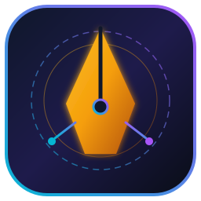

<div align="center">

  

  # OmniScribe Studio (*Codename: DaoForge*)
  **Autonomous Multi-Agent Literary Engine, World-Building Graph & RL Manuscript Suite**

  [](https://python.org)
  [](https://docs.astral.sh/uv/)
  [](https://fastapi.tiangolo.com)
  [](https://angular.dev)
  [](https://neo4j.com)
  [](LICENSE)

  ---

  <!-- Top Horizontal Navigation Bar -->
  <p align="center">
    <a href="#-system-architecture"><kbd>🏛️ Architecture</kbd></a> •
    <a href="#-project-tree"><kbd>📂 Project Tree</kbd></a> •
    <a href="#-reinforcement-learning--trait-dna"><kbd>🧬 RL Trait DNA</kbd></a> •
    <a href="#-quick-start"><kbd>🚀 Quick Start</kbd></a> •
    <a href="docs/ARCHITECTURE.md"><kbd>📐 Deep-Dive Docs</kbd></a> •
    <a href="docs/CONTRIBUTING.md"><kbd>🤝 Contributing</kbd></a>
  </p>

  ---
</div>

## 🌟 Overview

**OmniScribe Studio** is a production-grade AI literary ecosystem built for novelists writing across **Xianxia, Wuxia, Martial Arts, Western Fantasy, Cyberpunk, Steampunk, Horror, Urban, and Dark/Mature Fiction**. Designed specifically to orchestrate specialized **7B–15B parameter local LLMs/SLMs** (such as *Dao-9B*, *Qwen-2.5-14B*, and uncensored GGUF/EXL2 weights), it eliminates chatbot clichés, maintains multi-book continuity via GraphRAG, and evolves its writing agents through Reinforcement Learning.

<details open>
<summary><b>✨ Core Capabilities (Click to Expand / Collapse)</b></summary>

- **📚 Multi-Format & Web Ingestion:** Ingest `.epub`, `.pdf`, `.docx`, `.md`, local chapter directories, or web novel URLs with automatic genre classification and Neo4j entity extraction.
- **🐉 Native Raw Translation (`Dao-9B` Pipeline):** Translates Chinese raws or polishes stiff MTL into authentic Wuxia/Xianxia/Fantasy prose in parallel paragraph batches.
- **🧠 Multi-Agent Writer's Room (Non-Blocking Chat):** Parallel WebSocket + Redis Pub/Sub bus where genre specialists, combat choreographers, dialogue polishers, and unfiltered dark-fiction sub-agents collaborate asynchronously while you continue chatting.
- **🧬 15-Dimension RL Trait DNA Engine:** Agents dynamically construct prompts from evolving numerical personality vectors stored in PostgreSQL (with automatic SQLite fallback).
- **🚫 Anti-Cliché & Granular Version Control:** Strips em-dashes (`—`), semicolons (`;`), and robotic phrasing at runtime, backed by paragraph-level diffing and instant Undo/Redo.
- **🎨 Studio Themes & Live Telemetry:** Angular 19 desktop interface featuring **Light Parchment**, **Dark Obsidian**, and **Neutral Grey Studio** modes with a live WebSocket telemetry terminal.

</details>

---

## 🏛️ System Architecture

<details>
<summary><b>🔍 View End-to-End Microservice & Data Flow Diagram (Click to Expand)</b></summary>

```mermaid
graph TD
    subgraph Frontend ["Angular 19 + Tauri Desktop App"]
        UI[Split-Pane Editor & Diff Viewer]
        Chat[Non-Blocking Multi-Agent Chat]
        LogBox[Live Telemetry & Progress Drawer]
    end

    subgraph Gateway ["Core Gateway (FastAPI + WebSockets)"]
        WS[WebSocket Multiplexer]
        REST[REST API Router]
    end

    subgraph Bus ["Async Message & Task Bus"]
        Redis[(Redis 7.4 Pub/Sub & Streams)]
    end

    subgraph Microservices ["uv Python Microservices"]
        Ingest[ingestion-scraper]
        Trans[translation-pipeline]
        Lore[rag-lore-engine]
        Swarm[agent-swarm + RL DNA]
        Editor[manuscript-editor]
        Trainer[model-trainer Unsloth]
    end

    subgraph Storage ["Polyglot Persistence Layer (./data)"]
        PG[(PostgreSQL 16 + SQLite Fallback)]
        Neo[(Neo4j 5 Knowledge Graph)]
        Qdrant[(Qdrant Vector Store)]
    end

    subgraph Models ["Local LLM Pool (vLLM / Ollama)"]
        Dao[Dao-9B Translation SLM]
        MainLLM[14B Prose / Genre LLM]
        Uncensored[14B Uncensored / Dark Specialist]
    end

    UI & Chat & LogBox <==> WS & REST
    WS & REST <==> Redis
    Redis <==> Ingest & Trans & Lore & Swarm & Editor & Trainer
    Swarm & Editor & Lore <==> PG & Neo & Qdrant
    Trans --> Dao
    Swarm & Editor --> MainLLM & Uncensored