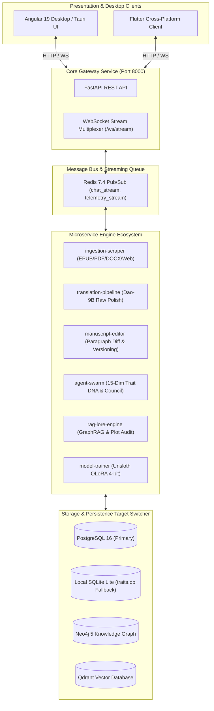
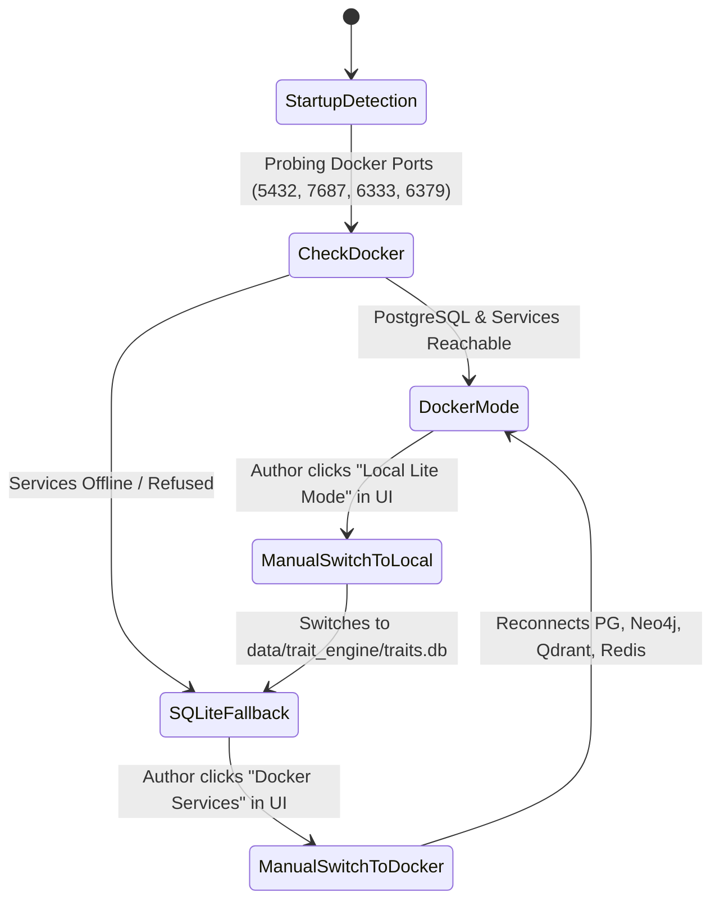

# OmniScribe Studio Architecture Deep Dive (Codename: DaoForge)

Comprehensive technical specification for OmniScribe Studio: polyglot persistence, non-blocking asynchronous multiplexing, 15-dimension Reinforcement Learning Trait DNA, and scalable web novel ingestion.

---

## 1. High-Level Architectural Flow

---

## 2. Storage Mode Switching Architecture

OmniScribe Studio implements a dynamic persistence layer managed by `shared-core/enterprise_database_service.py`:

---

## 3. Microservice Specifications

### `shared-core`
- **Location**: `services/shared-core`
- **Role**: Shared models, configuration, connection pool failover, and telemetry emission.
- **Failover Contract**: If PostgreSQL connection fails, seamlessly switches active session factory to `aiosqlite` at `data/trait_engine/traits.db` without crashing endpoints.

### `core-gateway`
- **Location**: `services/core-gateway`
- **Role**: High-throughput FastAPI hub. Exposes `/api/health`, `/api/settings/storage-mode`, chapter ingestion, parallel editing, and WebSocket multiplexing.

### `ingestion-scraper`
- **Location**: `services/ingestion-scraper`
- **Role**: Local file parsing (`.epub`, `.pdf`, `.docx`, `.md`, `.txt`) and web-scraping (Twkan, 69shuba, WTR-Lab, OpenNovel, Project Gutenberg) with Cloudflare bypass (FlareSolverr).

### `agent-swarm`
- **Location**: `services/agent-swarm`
- **Role**: 15-dimension Reinforcement Learning Trait DNA engine, topic routing, and multi-agent asynchronous writer's room.

### `manuscript-editor`
- **Location**: `services/manuscript-editor`
- **Role**: Paragraph-by-paragraph versioning, atomic rollbacks, anti-cliche scrubbing, and punctuation standardization.

### `rag-lore-engine`
- **Location**: `services/rag-lore-engine`
- **Role**: Character profiles, faction hierarchies, realm progressions, and plot continuity auditing via Neo4j and Qdrant.

### `model-trainer`
- **Location**: `services/model-trainer`
- **Role**: Incremental QLoRA instruction dataset export and automated training script generation for Unsloth.
